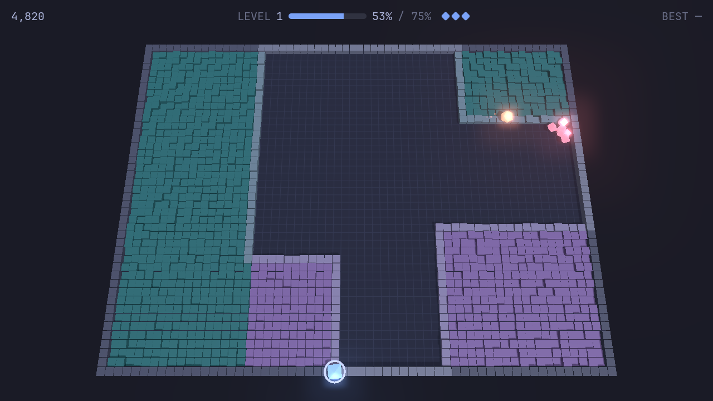

# Claim

A territory-claiming arcade game for [Omarchy](https://omarchy.org)'s Game Vibes. Cut lines across the field, close them to raise the land as cubes, and fence off 75% to clear the level without letting the wisp touch your line.



## Install

```bash
omarchy games vibes install https://github.com/lorismaz/omarchy-claim-game.git
```

## Controls

| Key | Action |
| --- | --- |
| Arrows / WASD | Move along the edge |
| Hold Space + move | Cut a line |
| Hold Shift + move | Cut slowly, for double points |
| Esc / P | Pause (Q from pause goes back to Game Vibes) |
| M / N | Sound / music on or off |
